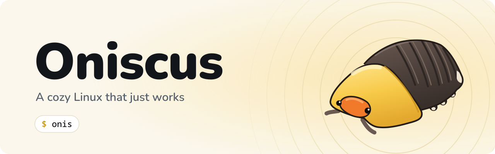

<p align="center">
  <picture>
    <source media="(prefers-color-scheme: dark)" srcset="art/repo/banner-dark.svg">
    
  </picture>
</p>

# Oniscus (image files still say Xi3)

[Português](README.pt-BR.md)

**A cozy Linux that just works.**

A distribution based on openSUSE Tumbleweed with XFCE and i3wm by default. i3 runs
as the window manager **inside** the XFCE session: XFCE handles the panel,
settings, power, notifications, disk mounting and Thunar, and i3 handles the
windows. The system is terminal-first. It uses only the official Tumbleweed
repositories (oss, non-oss and update), plus the Oniscus repository for the
distro's own packages, so they update with the rest of the system (see
[docs/packages.md](docs/packages.md)).

## Languages

English is the default language. Brazilian Portuguese is the second supported
language: its translations are installed, and the Oniscus tools and labels follow
`LANG`. To switch, pick Português in the XFCE settings or set
`LANG=pt_BR.UTF-8`. Code comments are in English, and every document has an
English and a Portuguese version (`*.pt-BR.md`).

## How it works

| Part | Choice |
|---|---|
| Base | openSUSE Tumbleweed (rolling release) |
| Image build | KIWI NG (the same tool openSUSE uses) |
| Login | Ly (terminal greeter on tty2) in the brand colors; only the Oniscus session is listed |
| Window manager | i3 instead of xfwm4 (set in `xfce4-session.xml`) |
| Top bar | xfce4-panel: menu, focused app, wifi, battery, clock, search |
| Bottom bar | Polybar as a floating pill: workspaces, CPU and RAM |
| Dock | Plank on the left, hides when a window touches it (intellihide) |
| Desktop | no xfdesktop (it would cover i3); wallpaper set with feh |
| Launcher | rofi (`Super+Space`, `Super+d` or the search icon in the top bar) and xfce4-appfinder |
| Compositor | picom, animating windows as they open, close and resize |
| Theme | dark Xi3 Retro with a yellow accent (original, 2000s style), Oxygen icons, Noto Sans |
| Terminal | the focus of the system: opens at login, first in the dock, Starship prompt and fastfetch with the mascot |
| Audio | PipeWire |
| Media | VLC is the default player for video and music (also `vlc -I ncurses` in the terminal); the optional Packman step adds `vlc-codecs` |
| Welcome app | `onis` command (bash + gum): opens at login and with `Super+Alt+Space`. See [docs/onis.md](docs/onis.md) |

## Layout

```
distro/
├── build.sh                      # builds the ISO with kiwi-ng
├── art/                          # wallpaper generator and brand files
├── docs/                         # extra documentation
├── packaging/                    # RPM spec, file manifest and OBS service
└── kiwi/
    ├── config.kiwi               # packages, repositories, image type (UEFI live ISO)
    ├── config.sh                 # services, greeter, live user, language
    └── root/                     # files copied on top of the image
```

System defaults go in `/etc/xdg` (applied to every new user), and user configs
(i3, Polybar, picom, fastfetch) go in `/etc/skel`, which is copied to each new
home directory.

## Design

Interactive mockup: https://claude.ai/artifact/5JJzRi9e9jw8pyLk2tnp5i

Files that implement the design (under `kiwi/`):

- `root/etc/xdg/xfce4/xfconf/xfce-perchannel-xml/xfce4-panel.xml`: top bar
- `root/usr/local/bin/xi3-active-app`: focused app name (genmon plugin + xdotool)
- `root/etc/skel/.config/xfce4/panel/launcher-7/`: search button
- `root/usr/share/themes/Xi3-Retro/`: GTK theme (bars, buttons, panel)
- `root/usr/share/plank/themes/Xi3-Retro/`: dock theme
- `root/etc/xdg/xfce4/xfconf/xfce-perchannel-xml/xsettings.xml`: default theme, icons and font
- `root/etc/xdg/xfce4/xfconf/xfce-perchannel-xml/xfce4-terminal.xml`: terminal colors
- `root/etc/skel/.config/picom/picom.conf`: window animations
- `root/usr/share/wallpapers/xi3.jpg`: wallpaper (generated by `art/wallpaper.py`)
- `root/etc/skel/.config/polybar/`: bottom bar and the script that starts it
- `root/etc/ly/config.ini` and `root/usr/share/oniscus/xsessions/`: Ly greeter and the Oniscus session
- `root/etc/starship.toml`, `root/etc/profile.d/oniscus-starship.sh`, `root/etc/bash.bashrc.local`: prompt and fastfetch
- `root/etc/skel/.config/fastfetch/` and `root/usr/share/oniscus/logo.ansi`: fastfetch with the mascot
- `root/usr/share/pixmaps/oniscus-menu.svg`: mascot on the menu button
- `root/etc/xdg/mimeapps.list`: VLC as the default media player
- `root/etc/dconf/db/local.d/10-xi3-plank` and `root/etc/skel/.config/plank/`: dock

To check on the first build:

- i3 treats "dock" windows as top or bottom bars. Check that Plank really stays
  on the left inside i3; if it doesn't, the fallback is a vertical XFCE panel
  with autohide.
- A Mac-style global menu (File, Edit…) is not included: it needs
  vala-panel-appmenu, which hasn't been confirmed in the official repositories.
- The animations use picom 12 syntax; check the Tumbleweed version.
- Ly's `config.ini` uses the Ly 1.1+ color format (`0xSSRRGGBB`). Check the `ly`
  package version and whether the service is `ly.service` or `ly@tty2.service`.
- The panel battery plugin (`power-manager-plugin`) comes from xfce4-power-manager.
- The `-lang` translation package names in `config.kiwi`.
- Branding: that `branding-upstream`, `plymouth-branding-upstream` and
  `MozillaFirefox-branding-upstream` exist, that nothing pulls an openSUSE logo back
  (`rpm -qa '*branding*'`), and that GRUB, Plymouth, `/etc/issue` and fastfetch say Oniscus.
- VLC 3 installs `vlc.desktop` (used in `/etc/xdg/mimeapps.list`); VLC 4 renames it to
  `org.videolan.vlc.desktop`. Check the name and that `vlc-qt`, `vlc-lang` exist.
- The `.desktop` file names used in the dock (thunar, xfce4-terminal, firefox,
  org.xfce.mousepad, xfce-settings-manager).

## Building the ISO

On openSUSE (a VM or a privileged `opensuse/tumbleweed` container works):

```bash
sudo zypper install python3-kiwi kiwi-systemdeps
./build.sh
qemu-system-x86_64 -enable-kvm -m 4G -bios /usr/share/qemu/ovmf-x86_64.bin -cdrom out/*.iso
```

Without a local machine: create a project on the Open Build Service
(build.opensuse.org) under `home:<user>` and upload the `kiwi/` folder. OBS
rebuilds the ISO whenever Tumbleweed changes.

## Licenses

Everything can be published: our own files are GPL-3.0-or-later (artwork is
CC BY-SA 4.0) and everything else comes from the official repositories. Details
in [LICENSES.md](LICENSES.md).

## Status

Initial skeleton, **not yet tested in a real build**. Package names were
written for Tumbleweed but must be confirmed with `zypper search` on the first
build.

## Next steps

1. First build and VM test; fix any missing package names.
2. Test the installer. The live ISO boots in English, US keyboard and UTC; the
   Calamares installer ("Install Oniscus" in the menu) asks for the language,
   keyboard layout and time zone, creates the user's account and then removes
   the live user, its passwordless sudo and its hint in Ly. Config in
   `kiwi/root/etc/calamares/`. To check: that `calamares` is in the official
   Tumbleweed repo, and that copying the running live system (`unpackfs` from
   `/`) works with KIWI's live image.
   The installer also offers two optional steps, both unchecked: the official
   NVIDIA repository with the recommended driver, and the Packman codecs. Neither
   is shipped in the ISO; they are downloaded during installation
   (`calamares/modules/contextualprocess-oniscus-extras.conf`).
3. openSUSE's trademark rules don't allow using the "openSUSE" name or logo as
   your distro's name; "based on openSUSE Tumbleweed" is allowed.
4. Config updates: today they are baked into the image. For future changes to
   reach existing installs, they would need to be packaged as an RPM
   (`xi3-desktop-config`), which requires our own OBS repository (system packages
   would still come only from Tumbleweed).
