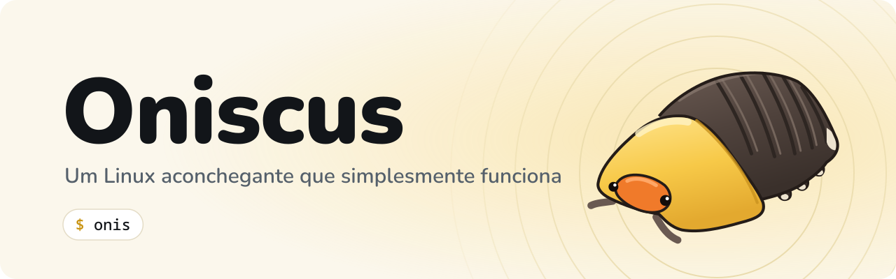

<p align="center">
  <picture>
    <source media="(prefers-color-scheme: dark)" srcset="art/repo/banner-dark.pt-BR.svg">
    
  </picture>
</p>

# Oniscus (os arquivos da imagem ainda dizem Xi3)

[English](README.md)

**Um Linux aconchegante que simplesmente funciona.**

Distribuição baseada no openSUSE Tumbleweed com XFCE e i3wm por padrão. O i3 roda
como gerenciador de janelas **dentro** da sessão XFCE: o XFCE cuida de painel,
configurações, energia, notificações, montagem de discos e Thunar, e o i3 cuida das
janelas. O sistema é focado no terminal. Usa os repositórios oficiais do
Tumbleweed (oss, non-oss e update) e o repositório do Oniscus para os pacotes
próprios da distro, que assim se atualizam com o resto do sistema (veja
[docs/packages.pt-BR.md](docs/packages.pt-BR.md)).

## Idiomas

O inglês é o idioma padrão. O português do Brasil é o segundo idioma suportado:
as traduções vêm instaladas, e as ferramentas e textos do Oniscus seguem o `LANG`.
Para trocar, escolha Português nas configurações do XFCE ou defina
`LANG=pt_BR.UTF-8`. Os comentários de código são em inglês, e todo documento tem
versão em inglês e em português (`*.pt-BR.md`).

## Como funciona

| Peça | Escolha |
|---|---|
| Base | openSUSE Tumbleweed (rolling release) |
| Build da imagem | KIWI NG (a mesma ferramenta que o openSUSE usa) |
| Login | Ly (greeter no terminal, tty2) com as cores da marca; só a sessão Oniscus aparece |
| Gerenciador de janelas | i3 no lugar do xfwm4 (definido em `xfce4-session.xml`) |
| Barra superior | xfce4-panel: menu, app em foco, wifi, bateria, relógio, busca |
| Barra inferior | Polybar em pílula flutuante: áreas de trabalho, CPU e RAM |
| Dock | Plank à esquerda, some quando uma janela encosta (intellihide) |
| Área de trabalho | sem xfdesktop (ele cobriria o i3); papel de parede via feh |
| Lançador | rofi (`Super+Espaço`, `Super+d` ou a lupa da barra de cima) e xfce4-appfinder |
| Compositor | picom com animações de abrir, fechar e redimensionar janelas |
| Tema | Xi3 Retrô escuro com realce amarelo (próprio, estilo anos 2000), ícones Oxygen, fonte Noto Sans |
| Terminal | foco do sistema: abre sozinho no login, primeiro no dock, prompt Starship e fastfetch com o mascote |
| Áudio | PipeWire |
| Mídia | VLC é o player padrão de vídeo e música (também `vlc -I ncurses` no terminal); a etapa opcional do Packman adiciona o `vlc-codecs` |
| Boas-vindas | comando `onis` (bash + gum): abre no login e no `Super+Alt+Espaço`. Veja [docs/onis.pt-BR.md](docs/onis.pt-BR.md) |

## Estrutura

```
distro/
├── build.sh                      # gera a ISO com kiwi-ng
├── art/                          # gerador do papel de parede e arquivos da marca
├── packaging/                    # spec RPM, manifesto de arquivos e serviço do OBS
├── docs/                         # documentação extra
└── kiwi/
    ├── config.kiwi               # pacotes, repositórios, tipo de imagem (ISO live UEFI)
    ├── config.sh                 # serviços, greeter, usuário live, idioma
    └── root/                     # arquivos copiados por cima da imagem
```

Os padrões do sistema ficam em `/etc/xdg` (valem para todo usuário novo), e as
configs de usuário (i3, Polybar, picom, fastfetch) ficam em `/etc/skel`, que é
copiado para o home de cada usuário criado.

## Design

Mockup interativo: https://claude.ai/artifact/5JJzRi9e9jw8pyLk2tnp5i

Arquivos que implementam o design (dentro de `kiwi/`):

- `root/etc/xdg/xfce4/xfconf/xfce-perchannel-xml/xfce4-panel.xml`: barra superior
- `root/usr/local/bin/xi3-active-app`: nome do app em foco (plugin genmon + xdotool)
- `root/etc/skel/.config/xfce4/panel/launcher-7/`: botão de busca
- `root/usr/share/themes/Xi3-Retro/`: tema GTK (barras, botões, painel)
- `root/usr/share/plank/themes/Xi3-Retro/`: tema do dock
- `root/etc/xdg/xfce4/xfconf/xfce-perchannel-xml/xsettings.xml`: tema, ícones e fonte padrão
- `root/etc/xdg/xfce4/xfconf/xfce-perchannel-xml/xfce4-terminal.xml`: cores do terminal
- `root/etc/skel/.config/picom/picom.conf`: animações das janelas
- `root/usr/share/wallpapers/xi3.jpg`: papel de parede (gerado por `art/wallpaper.py`)
- `root/etc/skel/.config/polybar/`: barra inferior e script que a inicia
- `root/etc/ly/config.ini` e `root/usr/share/oniscus/xsessions/`: greeter Ly e a sessão Oniscus
- `root/etc/starship.toml`, `root/etc/profile.d/oniscus-starship.sh`, `root/etc/bash.bashrc.local`: prompt e fastfetch
- `root/etc/skel/.config/fastfetch/` e `root/usr/share/oniscus/logo.ansi`: fastfetch com o mascote
- `root/usr/share/pixmaps/oniscus-menu.svg`: mascote no botão do menu
- `root/etc/xdg/mimeapps.list`: VLC como player de mídia padrão
- `root/etc/dconf/db/local.d/10-xi3-plank` e `root/etc/skel/.config/plank/`: dock

Pontos a testar no primeiro build:

- O i3 trata janelas do tipo "dock" como barras de cima/baixo. Precisa ver se o
  Plank fica mesmo na esquerda dentro do i3; se não ficar, a alternativa é um
  painel vertical do XFCE com autohide.
- Menu global estilo Mac (Arquivo, Editar…) não está incluído: depende do
  vala-panel-appmenu, que ainda não foi confirmado nos repositórios oficiais.
- As animações usam a sintaxe do picom 12; conferir a versão no Tumbleweed.
- O `config.ini` do Ly usa cores no formato do Ly 1.1 ou mais novo (`0xSSRRGGBB`).
  Conferir a versão do pacote `ly` e se o serviço é `ly.service` ou `ly@tty2.service`.
- O plugin de bateria do painel (`power-manager-plugin`) vem do xfce4-power-manager.
- Os nomes dos pacotes de tradução `-lang` no `config.kiwi`.
- Branding: se `branding-upstream`, `plymouth-branding-upstream` e
  `MozillaFirefox-branding-upstream` existem, se nada traz o logo do openSUSE de volta
  (`rpm -qa '*branding*'`) e se GRUB, Plymouth, `/etc/issue` e fastfetch dizem Oniscus.
- O VLC 3 instala `vlc.desktop` (usado em `/etc/xdg/mimeapps.list`); o VLC 4 troca para
  `org.videolan.vlc.desktop`. Conferir o nome e se `vlc-qt` e `vlc-lang` existem.
- Nomes dos arquivos `.desktop` usados no dock (thunar, xfce4-terminal, firefox,
  org.xfce.mousepad, xfce-settings-manager).

## Como gerar a ISO

Num openSUSE (pode ser uma VM ou um container `opensuse/tumbleweed` com privilégios):

```bash
sudo zypper install python3-kiwi kiwi-systemdeps
./build.sh
qemu-system-x86_64 -enable-kvm -m 4G -bios /usr/share/qemu/ovmf-x86_64.bin -cdrom out/*.iso
```

Alternativa sem máquina local: criar um projeto no Open Build Service
(build.opensuse.org) em `home:<usuario>` e subir a pasta `kiwi/`. O OBS gera a
ISO a cada mudança no Tumbleweed.

## Licenças

Tudo pode ser publicado: os arquivos próprios são GPL-3.0-or-later (arte em
CC BY-SA 4.0) e o resto vem dos repositórios oficiais. Detalhes em
[LICENSES.pt-BR.md](LICENSES.pt-BR.md).

## Situação atual

Esqueleto inicial, **ainda não testado num build real**. Os nomes de pacotes
foram escritos com base no Tumbleweed, mas precisam ser confirmados com
`zypper search` na primeira compilação.

## Próximos passos

1. Primeiro build e teste em VM; corrigir nomes de pacotes que faltarem.
2. Testar o instalador. A ISO live sobe em inglês, teclado US e UTC; o
   instalador Calamares ("Instalar o Oniscus" no menu) pergunta idioma, teclado e
   fuso, cria a conta do usuário e depois remove o usuário live, o sudo sem senha
   e o aviso dele no Ly. Config em `kiwi/root/etc/calamares/`. A conferir: se o
   `calamares` está no repositório oficial do Tumbleweed e se a cópia do sistema
   live em execução (`unpackfs` a partir de `/`) funciona com a imagem live do KIWI.
   O instalador também oferece duas etapas opcionais, ambas desmarcadas: o
   repositório oficial da NVIDIA com o driver recomendado e os codecs do Packman.
   Nada disso vai na ISO; é baixado durante a instalação
   (`calamares/modules/contextualprocess-oniscus-extras.conf`).
3. As regras de marca do openSUSE não permitem usar o nome ou o logo "openSUSE"
   como nome da sua distro; "baseada no openSUSE Tumbleweed" é permitido.
4. Atualização das configs: hoje elas são gravadas na imagem. Para que mudanças
   futuras cheguem a quem já instalou, elas teriam que virar um RPM
   (`xi3-desktop-config`), o que exige um repositório próprio no OBS (os pacotes do
   sistema continuariam vindo só do Tumbleweed).
